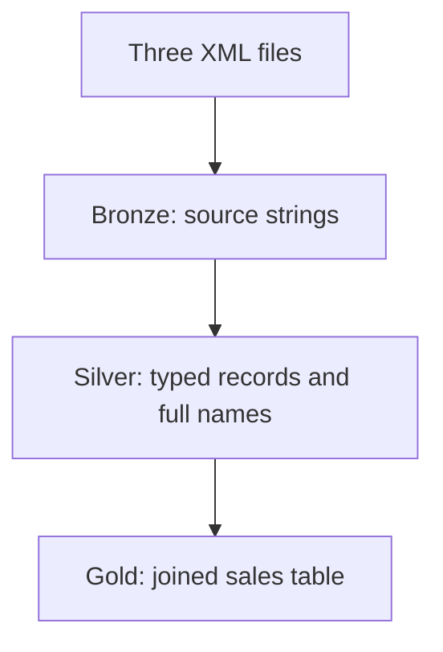

# XML Sales Data Warehouse

A batch ETL project that reads customer, product, and order XML files and loads a three-layer SQL Server warehouse.

## Data flow



- Parse XML with Python's ElementTree and build pandas DataFrames.
- Store source fields in `bronze.customers`, `bronze.products`, and `bronze.orders`.
- Convert identifiers, quantities, prices, and dates; combine customer names in Silver.
- Join orders to customers and products in `gold.fact`.
- Calculate `total_amount = quantity * price` at the source order-record grain.

## Files

| Path | Purpose |
| --- | --- |
| `project1.ipynb` | ETL notebook, run top to bottom |
| `Dataset/` | Supplied XML sample data |
| `SQLQuery1.sql` | Database, schemas, and table definitions |
| `Images/` | Original supporting image assets |
| `requirements.txt` | Python dependencies |

## Run locally

1. Install SQL Server and SSMS, Python 3.10+, and Microsoft ODBC Driver 17 for SQL Server.
2. In SSMS, execute `SQLQuery1.sql` on a fresh local instance/database. The DDL is a one-time setup, not a repeatable migration.
3. Open a terminal in this project directory and run:

```bash
python -m venv .venv
# Windows PowerShell:
.venv\Scripts\Activate.ps1
pip install -r requirements.txt
jupyter lab
```

4. Open `project1.ipynb`. Adjust `localhost` and the ODBC driver in its connection cells if required. The defaults use Windows integrated authentication with database `project1_dwh`.
5. Run all cells in order. The notebook must run with this project directory as its working directory so `./Dataset/` resolves.
6. Check the result in SSMS:

```sql
SELECT COUNT(*) AS sales_rows, SUM(total_amount) AS total_sales
FROM project1_dwh.gold.fact;
```

## Loading behavior and limits

Loads refresh each destination table using a transactional DELETE and append. Rerunning the entire notebook avoids duplicate appends; the whole pipeline is not one atomic transaction. Use only the project database, since existing target rows are deleted.

Gold uses inner joins: unmatched customer/product references are excluded. Validate source references before using other data. Prices use floating-point types as in the original exercise; fixed-precision decimal amounts would be preferable for financial production systems. Scheduling, incremental loading, and dashboards are not implemented.

## Validation

Notebook code syntax and XML transformation checks were performed during preparation. SQL Server execution requires your local database and ODBC installation; an end-to-end database run has not been verified in this environment. Stored notebook outputs were cleared to avoid stale results.
